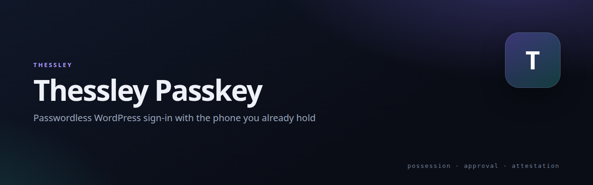

# Thessley Passkey

   

[](https://netmate1234.github.io/Thessley/)

Passwordless WordPress sign-in with the Thessley Passkey app: a QR code — or a one-tap link on the same phone — confirmed with the device's own biometric lock.

## Quick install

```sh
wp plugin install https://github.com/netmate1234/thessley-passkey-wordpress/releases/latest/download/thessley-passkey-1.0.0.zip --activate
```

Or upload the release zip under **Plugins → Add New → Upload Plugin**, then open **Thessley Passkey** and pick a login method.

**Verify:** `wp-login.php` shows the QR box. Add a phone from your profile page.

Requirements: WordPress 6.0+, PHP 8.3+.

## Three modes

| Mode | What the visitor sees |
|---|---|
| **Password or app** | Password form and QR side by side; whichever they reach for first works. |
| **Password, then app** | The password step runs first; the app confirms it. A stolen password alone is not enough. |
| **App only** | No password form for accounts with a device. Accounts without one keep the password fallback. |

## Devices and attestation

- Enrol from the profile screen — scan once, name the device, done.
- Attestation is verified server-side and shown for what it is: **TEE**, **StrongBox**, **TPM**, or software.
- Revoke a phone and every key it enrolled stops working immediately.
- An email notice on enrolment is the tripwire against a hijacked session adding a backdoor device.

## Install

1. Upload the `thessley-passkey` folder to `wp-content/plugins/`, or install the zip from [Releases](https://github.com/netmate1234/thessley-passkey-wordpress/releases).
2. Activate it, then choose a login method under **Thessley Passkey**.
3. Sign in on a phone with the app and add it from your profile screen.

**Upgrading from the old module:** the plugin reuses the same tables and options (`wp_thessley_passkeys`, `wp_thessley_passkey_requests`, `thessley_passkey_mode`), so enrolled devices and settings carry over. Install this before updating Thessley Security Hardening to 1.0.24.

Requires WordPress 6.0+ and PHP 8.3+. No external service: QR codes are drawn locally.

## Related

- [Thessley](https://github.com/netmate1234/Thessley) — the project family and overview deck
- [Thessley Security Hardening](https://github.com/netmate1234/thessley-security-hardening) — events from this plugin land in its Event Log when both are active
- [Thessley Passkey for Drupal](https://github.com/netmate1234/thessley-passkey-drupal) — the same protocol for Drupal
- [Passkey protocol](https://github.com/netmate1234/thessley-passkey-server) — the wire format behind both

## License

GPL-2.0-or-later.
